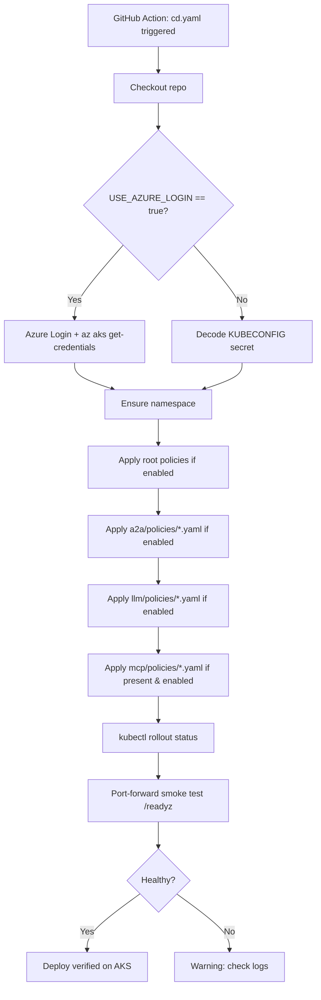

# Agent Gateway Deployment Flow on AKS

All values (namespace, cluster, enabled policies, runner, etc.) come from GitHub Variables / Secrets so the same workflow works across environments (dev / staging / prod).

## CD Trigger (push to main or workflow_dispatch)

## Required GitHub Variables / Secrets

| Name | Type | Purpose | Example |
|------|------|---------|---------|
| `AKS_RESOURCE_GROUP` | Variable | AKS resource group | `rg-agents` |
| `AKS_CLUSTER_NAME` | Variable | AKS cluster name | `aks-agents` |
| `AGENT_GATEWAY_NS` | Variable | Target namespace | `mcp-gateway` |
| `AGENT_GATEWAY_DEPLOY` | Variable | Deployment name | `agent-gateway` |
| `ENABLED_POLICIES` | Variable | Comma-separated basenames to apply (empty = all) | `rate-limiting,jwt-authentication,virtual-token-entra-obo` |
| `USE_AZURE_LOGIN` | Variable | `true` to use Azure Login instead of KUBECONFIG | `false` |
| `DEPLOY_ENVIRONMENT` | Variable | GitHub Environment name | `production` |
| `KUBECONFIG` | Secret | Base64-encoded kubeconfig (preferred) | |
| `AZURE_CREDENTIALS` | Secret | Service principal JSON (if USE_AZURE_LOGIN=true) | |
| `TEST_JWT` | Secret | Valid JWT for smoke tests | |

## What happens on Kubernetes / AKS

- Policies (AgentgatewayPolicy, AgentgatewayBackend, etc.) are applied via `kubectl apply`.
- The agentgateway controller (or Solo Enterprise controller) reconciles them into the data plane.
- Changes are hot-reloaded; no pod restart is required for most policy updates.
- Environment-specific values (issuer URLs, client IDs, secret names) should be parameterized in the YAML or injected via Kustomize / Helm in more advanced setups; the workflow itself stays fully dynamic.

## Related documentation

- **[CI and Version Control](CI-AND-VERSION-CONTROL.md)** — what the CI validates and how Git-based version control works for policies
