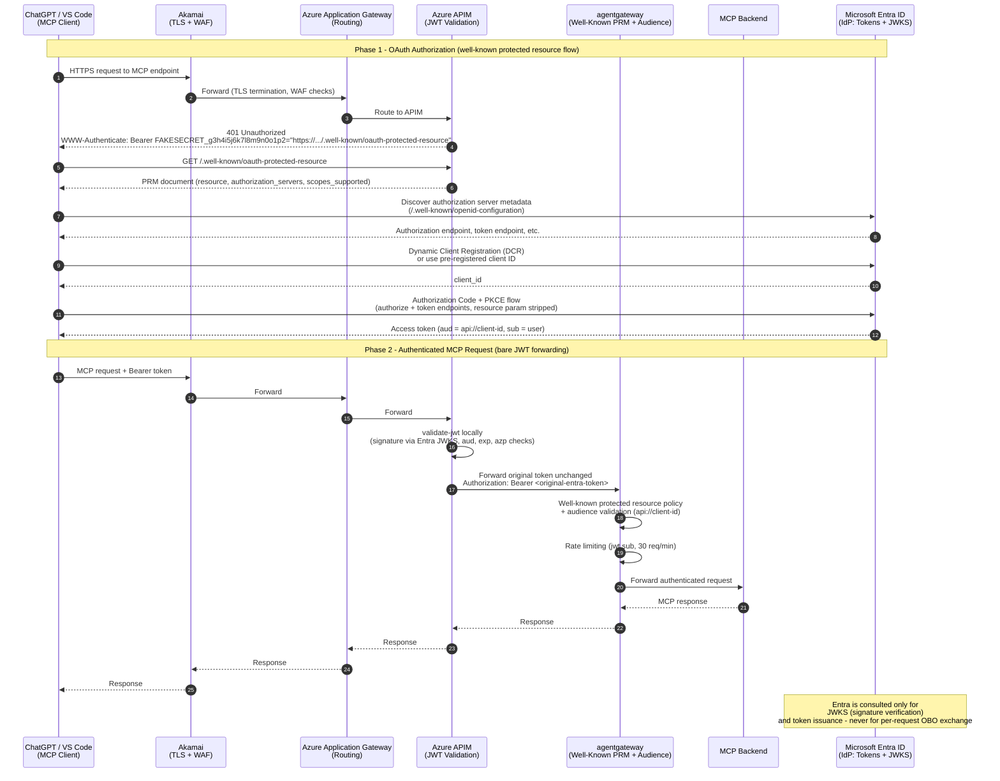

# Step 2: Bare JWT Forwarding Flow (Mermaid)

This diagram shows the recommended architecture: APIM performs local JWT validation only (no OBO token exchange) and forwards the original Entra token unchanged to agentgateway. agentgateway enforces the well-known protected resource policy and audience checks. Entra acts solely as the identity provider issuing tokens and serving JWKS.

## Sequence Diagram

## Component Responsibilities

| Component | Role |
| --- | --- |
| **ChatGPT / VS Code** | MCP client. Discovers the protected resource via the well-known PRM pointer, registers (or uses pre-registered client), runs the authorization code + PKCE flow with Entra, and attaches the resulting bearer token to every MCP request. |
| **Akamai** | Edge TLS termination and Web Application Firewall. No auth logic. |
| **Azure Application Gateway** | Layer 7 routing into the APIM VIP. No auth logic. |
| **Azure APIM** | **Bare JWT validation only.** `validate-jwt` checks signature against Entra's JWKS, audience, expiry, and authorized party. Forwards the *original* token unchanged - no OBO exchange, no new token minted. Optionally serves the `/.well-known/oauth-protected-resource` document and emits the 401 with the PRM pointer. |
| **agentgateway** | Enforcement point. Validates the JWT against Entra JWKS, enforces the well-known protected resource policy, checks audience matches agentgateway's configured list, applies rate limiting keyed on `jwt.sub`, and only then forwards to the MCP backend. |
| **MCP Backend** | The actual tool/service behind agentgateway. Trusts agentgateway's validation - receives a pre-authenticated request. |
| **Microsoft Entra ID** | Identity provider. Issues access tokens during the OAuth flow and serves JWKS for signature verification. Not called on the per-request data path. |

## Why No OBO

- **Latency:** OBO requires a synchronous call to Entra's token endpoint on every request (tens of milliseconds). Bare JWT validation is a local cryptographic check (microseconds).
- **Secret sprawl:** OBO needs a client secret (or managed identity) for the exchange, another credential to manage and rotate.
- **Failure mode:** If Entra is slow or unavailable, OBO blocks all traffic. With bare JWT forwarding, Entra being down only affects *new* token issuance - existing valid tokens still authenticate.
- **Security:** agentgateway still does full cryptographic validation (JWKS signature, audience, expiry) and enforces the well-known protected resource policy. APIM's validation is defense-in-depth, not the sole gate.

## Hardening Notes

- Pin agentgateway's accepted audiences to the exact Entra app registration values (both `api://<client-id>` and bare `<client-id>` forms if needed).
- Consider asserting the `azp`/`appid` claim if you want to restrict which client IDs can call through.
- Keep APIM's `validate-jwt` policy in place even though agentgateway re-validates - it drops junk traffic before it consumes agentgateway capacity.
- Rate limiting at agentgateway (keyed on `jwt.sub`) is the authoritative cap; APIM does not need its own limiter unless you want an earlier, coarser gate.
