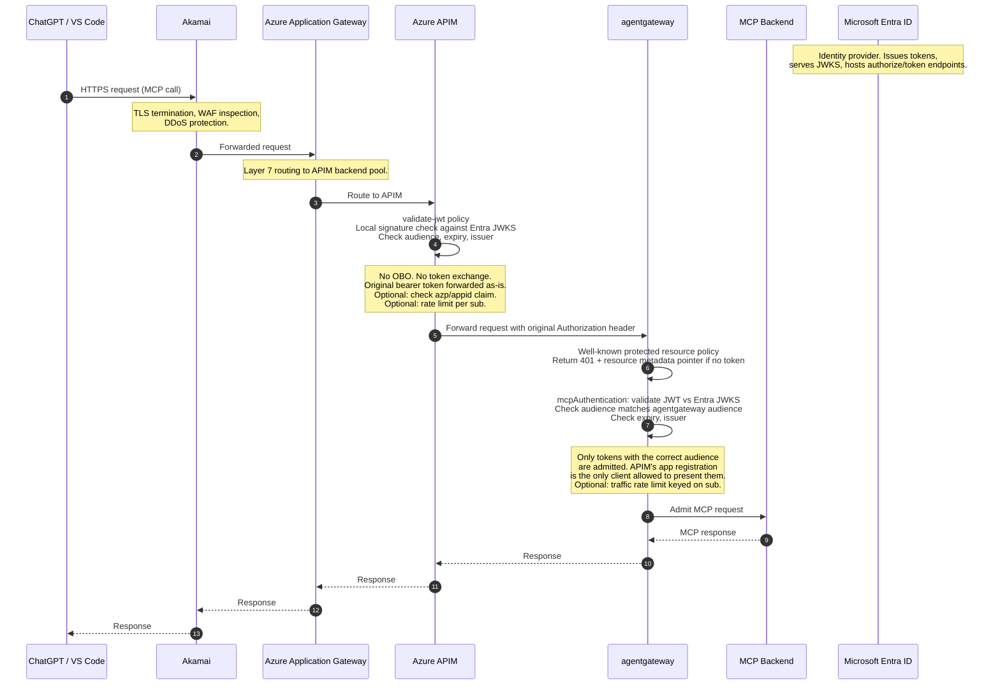

# Step 2: Bare JWT Validation Flow (No OBO)

This document captures the recommended architecture after reviewing the OBO option.
APIM performs local JWT validation only and forwards the original Entra token
unchanged to agentgateway. agentgateway enforces the well-known protected resource
policy and audience checks. Skipping OBO avoids per-request token minting latency,
extra secret management, and an additional failure mode.

## Sequence Diagram

## Component Responsibilities

| Component | Role |
| --- | --- |
| ChatGPT / VS Code | MCP client. Completes the OAuth authorization code + PKCE flow with Entra, then calls the MCP endpoint with the bearer token. |
| Akamai | Edge security. TLS termination, WAF, bot management. Does not touch tokens. |
| Azure Application Gateway | L7 reverse proxy. Routes traffic to the APIM backend pool. No auth logic. |
| Azure APIM | First auth hop. `validate-jwt` checks the token locally against Entra's JWKS (signature, audience, expiry, issuer). Forwards the original token unchanged. Does **not** mint a new token (no OBO). |
| agentgateway | Enforcement point. Serves the `.well-known/oauth-protected-resource` document, returns 401 with the metadata pointer when unauthenticated, validates the JWT natively, and only admits requests whose audience matches agentgateway's configured audience. Optionally rate limits per `sub`. |
| MCP Backend | The actual tool server. Only receives requests that survived both APIM and agentgateway. |
| Microsoft Entra ID | Issues the tokens the client holds and serves the JWKS that both APIM and agentgateway validate against. |

## Why Not OBO Here

- OBO adds a synchronous call to Entra's token endpoint on every request (tens of milliseconds each).
- It introduces a client secret (or managed identity) that APIM must hold and rotate.
- It creates a second token with a different audience that must be tracked end to end.
- Bare JWT validation is a local cryptographic check — microseconds, not milliseconds.
- agentgateway already performs the authoritative validation, so APIM's check is defense in depth, not the security boundary.

## Hardening Notes

- Keep APIM's `validate-jwt` audience list tight: only the Entra audiences the legitimate clients present.
- In agentgateway, list only the audience that APIM's app registration is allowed to carry, so the only path into agentgateway is through APIM.
- Consider asserting the `azp` or `appid` claim in agentgateway to bind the token to APIM's specific client ID.
- Add the per-`sub` rate limit policy (already patterned in `a2a/policies/rate-limiting.yaml` and `mcp/policies/mcp-rate-limit.yaml`) to the same HTTP route.
