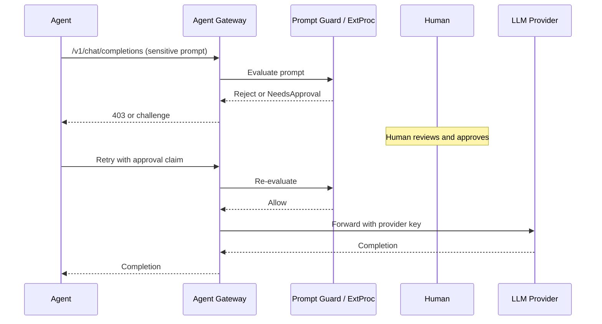

# Human-in-the-Loop for LLM

## How it works in OSS agentgateway

LLM traffic is request/response. HITL is realized by:

- Prompt guards that reject or flag content for later human review.
- External processing (ExtProc) that can hold or rewrite the request.
- Rate limits / token budgets that force a human to raise limits.
- Routing high-risk model calls through a separate path that requires an approval claim.

There is no native multi-round-trip elicitation on the LLM path the way MCP has.

## Policy patterns

1. **Prompt guard (moderation + regex)** — automatic block of harmful content.
2. **CEL authorization** — require `human_approved` claim for expensive or sensitive models.
3. **External processing** — send prompt to a human review service before forwarding to the provider.

## Edge cases

| Edge case | Handling |
|-----------|----------|
| Jailbreak / prompt injection | Prompt guard rejects; audit mode for logging |
| High-cost generation | Token budget or rate limit returns 429; human raises budget |
| Streaming responses | Enable streaming guardrails so partial output is filtered |
| Approval latency | Fail-closed timeout; never auto-approve |
| Credential isolation | Provider keys stay in Secrets; HITL does not expose them |

## Flow (Mermaid)

## Example

See `llm/policies/prompt-guard.yaml` for the automatic rejection case. Combine with a CEL rule that looks for a `human_approved` claim for interactive HITL.
