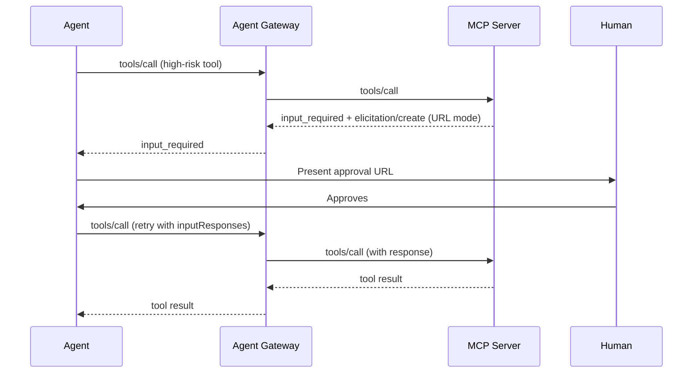

# Human-in-the-Loop for MCP

## How it works in OSS agentgateway

MCP servers can return an `input_required` result containing an `elicitation/create` request (form mode or URL mode). The client presents the form or opens the URL for the human, then retries the original `tools/call` with the response.

Open-source agentgateway is protocol-aware and proxies these multi-round-trip exchanges. It does **not** store elicitation state or provide a UI (Enterprise does).

## Policy patterns

1. **Tool-level authorization (CEL)**  
   Deny high-risk tools by default; allow only after a human-approved claim is present.

2. **Elicitation passthrough**  
   Let the MCP server trigger elicitation; gateway simply forwards.

3. **External authorization**  
   Call an external service that implements the approval queue and returns allow/deny.

## Edge cases

| Edge case | Handling |
|-----------|----------|
| Timeout of human response | Client or server should treat as deny (fail-closed) |
| Replay of old elicitation | Bind request state to user + tool + expiry |
| Sensitive data in form mode | Prefer URL mode for secrets; never collect passwords in form fields |
| Concurrent approvals | Use unique request IDs and idempotency |
| Bypass via direct tool call | Enforce gateway as the only path; rewrite agent cards |

## Flow (Mermaid)



## Example CEL deny (edge policy)

```yaml
apiVersion: agentgateway.dev/v1alpha1
kind: AgentgatewayPolicy
metadata:
  name: mcp-hitl-high-risk
spec:
  targetRefs:
    - group: agentgateway.dev
      kind: AgentgatewayBackend
      name: payments-mcp
  traffic:
    authorization:
      rules:
        - deny: mcp.tool.name in ["transfer_funds", "delete_account"] && !jwt.claims.human_approved
```

Place the full policy in `mcp/policies/` when you need it.
