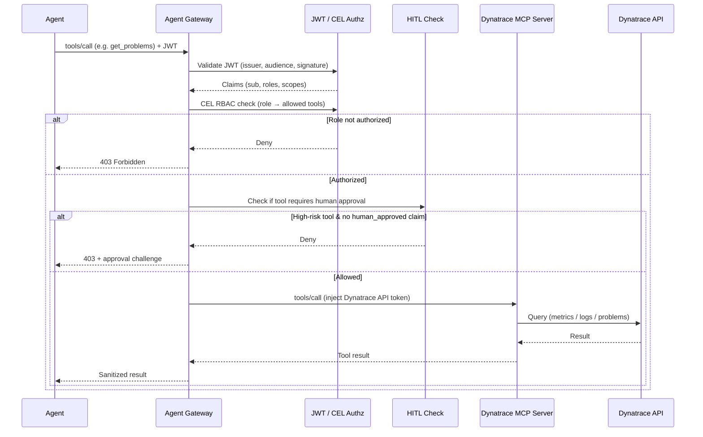

# Dynatrace MCP Security Flow

## End-to-End Flow (Mermaid)

## RBAC Model (example)

| Role | Allowed Tools | Notes |
|------|---------------|-------|
| `observer` | get_problems, get_metrics, get_logs | Read-only |
| `sre` | observer + create_alert, update_maintenance_window | Can change configuration |
| `admin` | all tools | Full access; HITL still applies to destructive tools |

Roles come from the JWT `roles` or `groups` claim.

## Credential Isolation

- Agents never see the Dynatrace API token.
- The token lives only in a Kubernetes Secret referenced by the AgentgatewayBackend.
- The gateway injects it on the upstream call to the Dynatrace MCP server.

## Deployment

The existing CD workflow applies all YAMLs under `mcp/use-cases/dynatrace-mcp/policies/` when their basenames are listed in `ENABLED_POLICIES` (or when the variable is empty).
